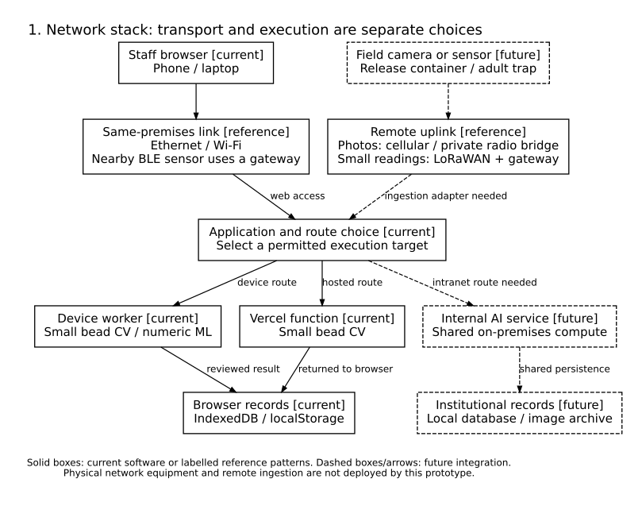
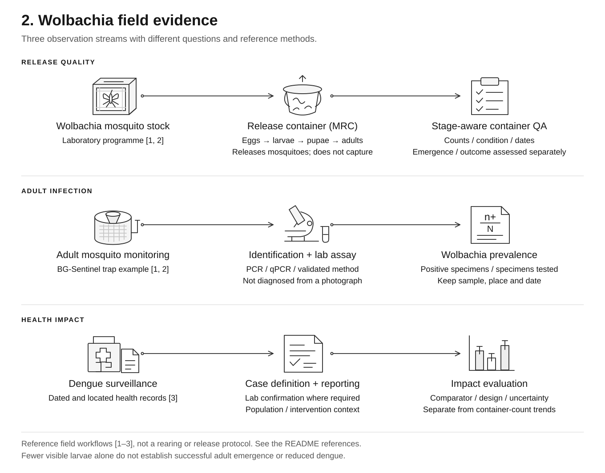
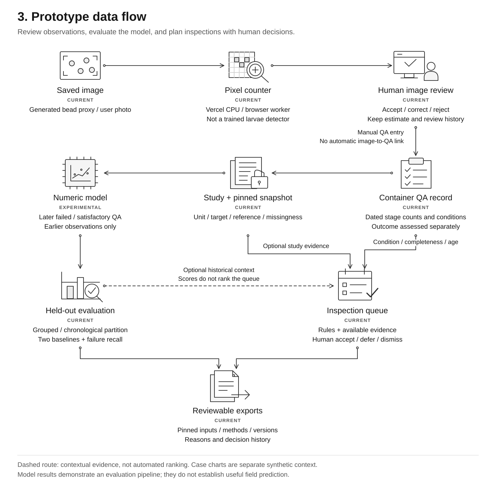
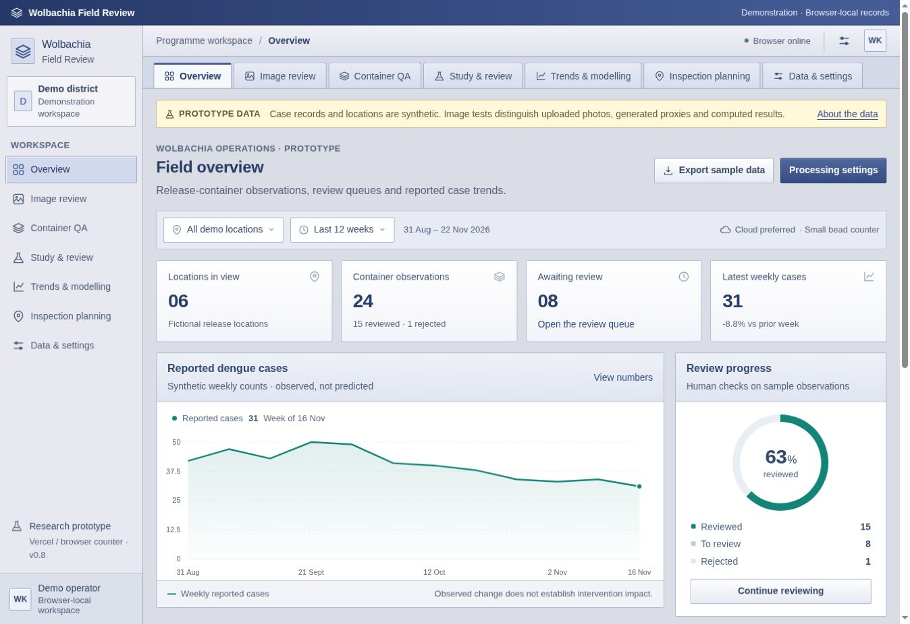

# Wolbachia Field Review

A research prototype for **release-container checks, reviewable observations and inspection planning**. This front page explains the network stack and the public-health data system before introducing the application.

[Open the live dashboard](https://workshop-ready-theta.vercel.app/) · [Technical guide and setup](docs/technical-guide.md) · [Three goals and current workplan](docs/remaining-steps-and-goals.md) · [MIT licence](LICENSE)

**Delivery goals:** network visibility, a practical public-health collection/review trial, and cloud-first processing with local fallback. Firebase is an optional connector point. Owner-operated laptop/photo checks are scheduled after implementation. See the [remaining steps, owners and hours](docs/remaining-steps-and-goals.md).

**Current demonstration:** prepared bead images, fictional locations and synthetic records. The image counter runs on Vercel or in a browser worker. Container records, study checks, numeric model evaluation and inspection planning are implemented. Field cameras, biological image validation, intranet deployment, shared storage and live Firebase verification are later or unfinished work.

## 1. Network system setup

**The connection carrying data and the computer analysing it are separate choices.** A Wi-Fi camera can send data to an internal server; a wired workstation can use a public service. An internal network can work without public internet when its application, software assets, models and records are available locally.

*Figure 1. Network patterns and execution targets. Components are labelled current, future or reference; dashed routes identify future integration. The figure is a deployment reference, not a claim that this repository has installed a field network.*

| Layer | What it does | This project and possible extensions |
|---|---|---|
| Collection | Produces an observation | Current: user-selected images and entered records. Future: cameras, sensors and device firmware. |
| Network | Carries the data | Same premises: Ethernet or Wi-Fi. Nearby BLE sensors need a compatible receiver/gateway. Remote sites need a suitable uplink. |
| Messaging | Defines the request or message | Current: HTTPS image-count requests. Future: MQTT for small sensor/status messages; MQTT does not itself extend radio range. [N1] |
| Computation | Processes pixels or fits a model | Current: Vercel CPU counter and browser computation. Future: an internal server or a validated device model. |
| Storage and review | Retains evidence and decisions | Current: browser records, versioned reviews and exports. Future: shared institutional database, image archive and user access. |

### One premises or several kilometres?

| Deployment | Data and possible connection | Consequence |
|---|---|---|
| Workshop, warehouse, factory, office or shop | Ethernet for fixed equipment; Wi-Fi for mobile or awkward-to-cable devices | Several clients can share one on-premises AI server. Every phone/camera need not run the model. |
| Distributed release containers or traps; photographs needed centrally | Available Wi-Fi through a cellular gateway, a cellular-enabled node, or a surveyed private radio bridge | Upload scheduled images; provide power, coverage, local buffering and a path to the centre. |
| Distributed devices; only small readings needed | LoRaWAN node → gateway → application | Suitable for temperature, battery/status and a count already obtained locally. Ordinary photo transfer is a poor fit. [N2] |
| No dependable uplink | Store locally and synchronise or collect later | The centre receives delayed observations. Capture time and upload time must stay distinguishable. |

One gateway can serve a cluster only where coverage permits. A single ordinary Wi-Fi/Bluetooth network is not assumed to cover a scattered city-wide deployment. A cellular uplink can terminate at an institution's own server; it does not require public-cloud AI.

**Implementation boundary.** The current choices are Vercel/browser routes, not a finished intranet installation. An internal deployment needs a production server package, an explicit internal-server route, trusted HTTPS and optional shared records. Reachability must be checked against the actual server: the browser's online flag does not reliably distinguish internet access from a working LAN. [N3] Supabase is not connected in the current build.

### Observable routes — step 6A

Open **Data & settings** or **Image review → Your saved images** for the **Network & processing** panel. It separates the browser's connection hint, an explicitly checked service response, local browser capabilities and the actual runtime retained with an image result. **Check bead service** sends only a bounded metadata request; it uploads no photo and does not invoke Firebase or a model. Connection changes clear the last check; its timestamp describes a point-in-time result, not continuous monitoring.

| Implemented path | Data crossing the path | Evidence shown |
|---|---|---|
| Browser → same-origin `GET /api/count-image` | No image, credentials or record payload | Validated counter version/runtime and last-check time; HTTP errors, wrong metadata and timeouts remain unverified |
| Browser → same-origin `POST /api/count-image` | Reduced RGB pixels, settings and fingerprints | `vercel-function` on Vercel; `development-server` on the development adapter |
| Browser → local worker | Pixels transferred within the device; no image upload | `browser-worker` in the saved result |
| Browser → IndexedDB/localStorage | Local images, results and workspace records | Browser-local persistence and exports; no shared database sync |

Cloud-first permits worker fallback on service failure. Cloud-only and device-only retain their restrictions; integrity failures are surfaced rather than replaced with a fallback answer. The local capability check does not execute a count or establish cold offline reopening. See [6A implementation and verification](docs/wolbachia-step-6a.md) and the completed controlled offline checks in [step 6B](docs/wolbachia-step-6b.md).

### Prepared offline use — step 6B

**Data & settings → Prepare for offline use** confirms that this app version and every required asset, including its counting worker, are saved on this browser. Prepare while connected, then reopen the same link in the same browser/profile without internet. Cloud-first then permits local bead counting, record saving, human review and CSV/JSON export. Reconnecting restores permitted hosted computation while the records stay local.

Cold reopening, a second complete browser restart, offline review/export, cache repair, a mixed-release guard and reconnection passed in seven controlled browser scenarios. The suite also verifies that a never-prepared browser cannot cold-open offline and that cloud-only remains blocked. Wili's own laptop check is deferred. See [the implementation, evidence and short offline checklist](docs/wolbachia-step-6b.md). This fallback is small classical CV, separate from the optional Firebase/local language-model route.

## 2. Wolbachia collection, evidence and ML system

The focus is **operational quality assurance (QA)**: keeping observations traceable and helping people decide what to inspect. The illustrated release-container programme introduces Wolbachia-carrying mosquitoes; it is distinct from a trap intended to collect adult specimens. These diagrams explain data roles, not rearing or release instructions.

*Figure 2. Three evidence streams. Field-reference processes are drawn from [1–3]; the prototype does not automate the whole programme. Ordinary photographs cannot determine Wolbachia infection status.*

| Evidence stream | Established field role | What our prototype supports |
|---|---|---|
| Release-container observations | Yogyakarta work used pupal skins and dead-stage observations for container QA. [1] Townsville work combined stage observations with timing to estimate emergence and inform operations. [2] | Dated, stage-aware count/condition records; temperature source; independently entered emergence/outcome assessments; revisions and reasons. |
| Adult mosquito monitoring and laboratory tests | Adult trapping supplies specimens for identification and infection assays. Infection prevalence needs tested specimens, not an image-based guess. [1, 2] | This is reference context. Trap ingestion, specimen tracking and a laboratory-results module are not implemented. |
| Dengue surveillance | Clinical outcomes and a suitable comparative design answer the public-health impact question; the AWED randomised trial is one example. [3] | Current charts are explicitly synthetic context. The model does not predict dengue reduction or estimate deployment's causal effect. |

A falling visible-larva count alone does not establish successful adult emergence. Images may miss objects, and stage, timing and reference methods matter. Release-container QA, adult infection prevalence and dengue impact remain different measurements. [1–3]

### From an observation to a reviewable decision

*Figure 3. Implemented prototype workflow. Image records and QA records remain separate; a person must enter the appropriate stage/context in QA. The dashed model-to-planning arrow is optional historical context, not automated ranking.*

| Component | Input → output | Scientific boundary |
|---|---|---|
| Image counting | Saved pixels → count/marked regions or refusal → human correction/rejection | Classical CV for separated bead proxies; not a trained or validated larvae detector. Actual Vercel/browser execution is labelled. |
| Container QA | Counts, dates, batch, condition and temperature provenance → versioned observation | Unknown differs from zero. Outcome and emergence assessments are separately recorded under a stated method. |
| Study and review | Dated question, unit, comparator, reference and pinned inputs → descriptive/readiness checks | Repeated units, exclusions and missing references are visible. No universal “30 samples proves validity” rule or automatic scientific certification. |
| Numeric ML | Earlier container observations → experimental later failed/satisfactory QA classification | Predictors include age, water temperature, stage ratios and condition. These are prototype candidate features, not established causal determinants or a published pretrained Wolbachia model. |
| Evaluation | Grouped, chronological held-out data → baseline comparisons and error evidence | Preprocessing uses training data only. Report missed failures as well as accuracy; retain provenance and versions. [M1] |
| Inspection planning | Available QA/study evidence → rule-based queue → human accept/defer/dismiss | Model scores and dengue charts do not rank the current queue. No release quantities or promised health effects are prescribed. |

The fixed **synthetic** ML example scores **60% accuracy versus 70% for the constant baseline**, and misses all three failed test containers. This demonstrates the evaluation pipeline; it does not establish useful field prediction. See the [complete method, exclusions and numerical checks](docs/wolbachia-step-4c.md).

The proposed contribution is a traceable review-and-evaluation workflow around observations. It is not a claim that existing Wolbachia programmes lack data systems or that this software improves their outcomes. Researcher collaboration would define a field protocol, obtain independent reference counts/outcome labels, evaluate an appropriate detector, and test inspection usefulness on new data. Counts, infection assays and dengue records would be linked only under an explicit study design and access agreement.

## 3. Application overview

*Figure 4. Actual Vercel overview captured on 22 November 2026. Displayed cases, locations and sample observations are demonstration data, not field findings.*

**[Open Wolbachia Field Review](https://workshop-ready-theta.vercel.app/)** — no evaluator login required for the current demo.

The main views are **Overview**, **Image review**, **Container QA**, **Study & review**, **Trends & modelling**, **Inspection planning**, and **Data & settings**. A beginner-friendly, end-to-end user walkthrough will be added later. For now this section presents the main page; developers can use the existing [technical guide](docs/technical-guide.md).

### Current release and deployment status

| Available now | Still to verify or build |
|---|---|
| Vercel and browser bead counter; explicit routing and human review | Prepared-photo error measurements and biological detection validation |
| Container QA, study checks, real numeric fitting/evaluation and inspection workflow | Field usefulness and any new or improved model |
| Browser records, history and CSV/JSON/report exports | Shared institutional storage, field devices and intranet deployment |
| Network/service diagnostics, prepared offline assets, 111 automated tests plus the compiled-server check and seven offline browser scenarios | Owner-operated laptop checks and the optional Firebase/Chrome model route |

Firebase AI Logic and App Check adapter code remains separate and unverified. A working Vercel CV counter does not establish Firebase contest eligibility. The repository currently retains its existing visibility. See [setup and limitations](docs/technical-guide.md), [counter implementation](docs/vercel-counter.md) and the [current workplan](docs/remaining-steps-and-goals.md).

## References

Paper references explain field methods and evidence; they do not validate this prototype or its synthetic model.

1. **Tantowijoyo W et al. (2020).** *Stable establishment of wMel Wolbachia in Aedes aegypti populations in Yogyakarta, Indonesia.* PLOS Neglected Tropical Diseases 14(4):e0008157. [DOI / paper](https://doi.org/10.1371/journal.pntd.0008157). Relevant sections: MRC releases; container quality assurance; BGS surveillance; Wolbachia diagnostics.
2. **O'Neill SL et al. (2018, version 2).** *Scaled deployment of Wolbachia to protect the community from dengue and other Aedes transmitted arboviruses.* Gates Open Research 2:36. [DOI](https://doi.org/10.12688/gatesopenres.12844.2) · [open full text](https://pmc.ncbi.nlm.nih.gov/articles/PMC6305154.2/). Relevant sections: quality assurance procedures; monitoring; diagnostics. Version cited is the version consulted.
3. **Utarini A et al. (2021).** *Efficacy of Wolbachia-Infected Mosquito Deployments for the Control of Dengue.* New England Journal of Medicine 384:2177–2186. [DOI](https://doi.org/10.1056/NEJMoa2030243) · [open manuscript](https://pmc.ncbi.nlm.nih.gov/articles/PMC8103655/). Relevant distinction: randomised epidemiological evaluation, not inference from container photographs.

**Network and analytical references**

- **[N1]** Eclipse Mosquitto. [MQTT protocol documentation](https://mosquitto.org/man/mqtt-7.html): lightweight publish/subscribe messaging, including low-power sensors.
- **[N2]** The Things Network. [LoRaWAN limitations](https://www.thethingsnetwork.org/docs/lorawan/limitations/): small-payload, long-range use and photo-transfer limitations. [Private radio bridge example](https://www.cambiumnetworks.com/resource/bridge-in-a-box/): an equipment category, not a hardware recommendation or a surveyed link for this project.
- **[N3]** MDN. [Navigator.onLine](https://developer.mozilla.org/en-US/docs/Web/API/Navigator/onLine), [Web Crypto secure-context requirements](https://developer.mozilla.org/en-US/docs/Web/API/Web_Crypto_API), and [Web Bluetooth compatibility](https://developer.mozilla.org/en-US/docs/Web/API/Web_Bluetooth_API).
- **[M1]** scikit-learn. [Cross-validation](https://scikit-learn.org/stable/modules/cross_validation.html) and [data leakage](https://scikit-learn.org/stable/common_pitfalls.html#data-leakage). These inform evaluation practice; the current estimator is implemented in TypeScript, not imported from scikit-learn.

Figures 1–3 are original explanatory schematics with outline stencils, not reproductions of stock artwork or publication figures. [Editable SVGs and matching semantic DOT/Mermaid flowcharts](docs/figures/) are generated by [the diagram renderer](scripts/render-readme-diagrams.py); the original icon shapes and visual layouts are in [the stencil source](scripts/diagram_stencils.py). Run `python scripts/render-readme-diagrams.py` to regenerate them with the Python standard library. Figure 4 is a screenshot of this application's live demonstration. Code and original diagrams are under the [MIT licence](LICENSE); cited publications retain their own licences. This independent prototype is not endorsed by UGM, WMP, WHO or the cited authors.
